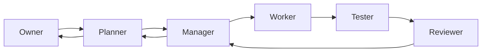

# CouncilFlow

**Clear briefs. Separate eyes. Evidence you can rerun.**

CouncilFlow is an installable workflow skill for existing AI coding environments.
It organizes a coding task into native agent roles and records the handoffs as
UTF-8 JSON. It is not a standalone assistant, runtime, provider, gateway, or
permission system.

## The working loop



The Planner preserves acceptance and checks it again at the end. The Manager
assigns work and evaluates independent evidence. The Worker implements. A fresh
Tester checks the exact candidate; a Reviewer compares it to the original plan
and reruns one recorded deterministic command. Only the Manager gives routine
progress and results to the Owner. The roles use the host's native tools,
models, permissions and delegation.

## Start with Codex

In this repository, invoke:

```text
$council-flow Implement a small offline CSV summarizer in this repository.
Accept a local input file, validate its columns, print totals, and add tests.
Stay within demo/csv-summary/ and preserve existing files.
```

To install in another repository: Copy the whole `.agents/skills/council-flow/` folder.
When supported, copy the four `.codex/agents/council-*.toml` files too. Keep existing files
and resolve name collisions first. Restart the host if it does not refresh skill
discovery. See [release contents](RELEASE.md).

## Host status

| Host | Entry point | Current evidence |
| --- | --- | --- |
| Codex | `$council-flow <goal>` | Native skill and role definitions; Gate 3 Run 01 remains `NATIVE_ROLE_WORKFLOW_PARTIAL` with E1/E2/E4 unverified. |
| Claude Code | `/councilflow:run <goal>` | Installable plugin; one recorded calc-001 smoke run passed. This does not establish universal compatibility. |

See [host package details](docs/technical/host-packages.md), [Gate 3 summary](reports/documentation-release-sync/gate3-run-01.md), and [Claude smoke summary](reports/documentation-release-sync/claude-calc-001.md).

## Codebase Memory context

The reference `.agents/skills/council-flow/references/codebase-memory.md` ships inside the complete skill folder copied during installation. No manual initialization command is required. No additional
skill or registration is needed. Static checks do not establish native invocation or live MCP behavior; see
[Codebase Memory context](docs/technical/codebase-memory.md) and run
`python -m unittest discover -s tests -p test_codebase_memory_integration.py -v`.

## Experimental model routing and SkillLab

The isolated [native model-routing experiment](experiments/native-model-routing/README.md)
validates route and qualification data. Its checked-in policy approves no model
pool. The native adapter only forms explicit request arguments; live effective
model identity remains `NATIVE_MODEL_ROUTING_UNVERIFIED` without permitted host
evidence. It does not dispatch providers or change configuration.

The optional [SkillLab adapter](experiments/skilllab-integration/adapter.py)
uses a pinned, read-only CLI as a Manager-side suggestion. It is limited to seven
eligible candidates; it cannot grant tools, actions or permissions. Selection
does not prove activation. The [A/B report](docs/benchmarks/native-model-routing.md)
records the completed offline fixture comparison and its limits without making
causal or savings claims.

## Tests and evidence

Run the offline product checks with Python 3.11 or newer:

```sh
python -m unittest discover -s tests -v
```

The focused synthetic routing tests are `python -m unittest tests.test_native_model_routing -v`.
They check data validation and negative controls; they do not prove live routing
or native activation. Browse the [technical index](docs/technical/README.md),
[routing capability record](evidence/native-model-routing/native-capability.json),
[benchmark evidence](docs/benchmarks/native-model-routing.md), and
[release guide](RELEASE.md).

## Authority and boundaries

The [Gate 3 Owner Charter](docs/gate3/CouncilFlow-Gate3-v0.2/01-OWNER-CHARTER.md),
existing Owner decisions, frozen specifications and role policy retain authority.
[Research proposals](docs/research/README.md) are non-normative. JSON contracts
and helper scripts preserve and validate records; they do not authenticate
senders, enforce native transport, or provide OS isolation. No test, package
build, or local simulation is evidence of native role activation.
